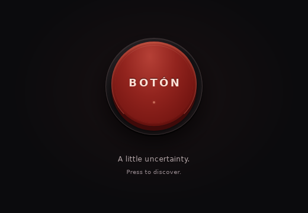

# BOTÓN

**One button. One random file. Absolute uncertainty.**

Press the button. A photograph, recording, document, or another unexpected piece
of the public Internet arrives in your Downloads folder. BOTÓN keeps the encounter
small: a dark window, a red button, a brief electronic click, and a filename when
the download is finished.

No accounts, categories, ads, analytics, or automatic file opening.



Actual Linux desktop capture from the installed `.deb`, using a virtual display.

**Validation:** 30 frontend tests and 23 native Rust tests pass, along with
TypeScript, frontend build, and native Clippy checks. Live public-source downloads
remain unverified because the development environment's proxy denies the archive
endpoints. See the [validation record](docs/validation.md) for exact results and
remaining platform checks.

## What it does

- Discovers real files through Internet Archive and Wikimedia Commons adapters.
- Streams downloads in Rust through HTTPS, with cancellation and bounded retries.
- Saves to your operating system's Downloads directory without replacing existing
  files.
- Asks before a file larger than 100 MiB, or one with an unknown size, is downloaded.
  A 2 GiB limit applies to every download.
- Checks permitted destinations, filenames, file types, available sizes and
  checksums before finalizing a download.
- Uses a local synthetic click and CSS animations, including reduced-motion
  support. There are no downloaded sounds or remote UI assets.

BOTÓN does not offer uniformly random access to the entire Internet. See
[how randomness works](#how-randomness-works) before interpreting the results.

## Install on Linux Mint or Ubuntu

The packaging target is **Linux Mint 22 / Ubuntu 24.04, x86_64**. Older distributions
may lack the required WebKitGTK 4.1 or system-library versions. Do not install a
package built on a newer distribution merely because its filename ends in `.deb`.

A successful Linux run of [the build workflow](https://github.com/fkxtr/The-Button/actions/workflows/ci.yml)
produces a `boton-linux-amd64-deb` artifact. Download and extract that artifact from
the run's summary, then run from the extracted directory:

```sh
sudo apt install ./boton_*_amd64.deb
boton
```

The package also installs a desktop launcher. CI artifacts are build outputs,
not a claim that a signed public release has been published. If no successful
artifact is available, build from source using the instructions below.

## Use

Launch BOTÓN and press the central button, or focus it and press Space or Enter.
The loading indicator means discovery or downloading is in progress. Press Escape
to cancel. If a large-file confirmation appears, accept it or decline to return
to the idle state. A finished filename appears briefly; the file is in Downloads.

Downloaded content is never opened automatically. An unavailable archive or
rejected file produces a short error, after which you can try again.

## Build from source

Install **Node.js 24 LTS**, npm, and [rustup](https://rustup.rs/). The repository's
`rust-toolchain.toml` selects the Rust version and components used by CI.
On Linux Mint 22 or Ubuntu 24.04, install Tauri's native
dependencies:

```sh
sudo apt update
sudo apt install -y build-essential pkg-config curl wget file \
  libwebkit2gtk-4.1-dev libxdo-dev libssl-dev \
  libayatana-appindicator3-dev librsvg2-dev

git clone https://github.com/fkxtr/The-Button.git
cd The-Button
npm ci
rustup component add rustfmt clippy
npm run tauri dev
```

The development command opens the native Tauri window. `npm run dev` starts only
the frontend server and does not provide the native download commands.

Build and install a release package on the target distribution:

```sh
npm run tauri build -- --bundles deb
sudo apt install ./src-tauri/target/release/bundle/deb/boton_*_amd64.deb
boton
```

No administrator privileges are needed to run BOTÓN or save files to your own
Downloads directory. Installing system dependencies or a system-wide package
normally requires administrator privileges.

### Windows

The application uses cross-platform Tauri APIs, and an optional Windows compile
job is available through the workflow's manual dispatch. **Windows runtime
behavior has not been verified.** No tested Windows installer is promised.

To attempt a source build, install Node.js 24, Rust's MSVC toolchain, Microsoft
C++ Build Tools with **Desktop development with C++**, and Microsoft Edge WebView2.
Follow [Tauri's Windows prerequisites](https://v2.tauri.app/start/prerequisites/#windows),
then run `npm ci` and `npm run tauri dev` from the checkout. To compile without
packaging, use `npm run tauri build -- --no-bundle`.

## How randomness works

BOTÓN chooses among source adapters and samples live API results using the
operating system's cryptographic random generator. Internet Archive contributes
multiple media groups and item metadata; Wikimedia Commons contributes random
file-namespace entries and their original file metadata. The chosen candidate
must pass URL, format, size, and transfer validation before it becomes a download.

This is sampling from particular archives, not the whole Internet. Archive
coverage, API result ordering, sampling windows, media-group choices, availability,
and safety filters all affect the distribution. Sources with more reachable files
can contribute more successful downloads when another source fails. Commons is
especially rich in images; grouping Archive queries helps other formats appear
without guaranteeing equal frequencies.

The implementation supports selected images, PDFs, text/HTML, audio, and video.
Executable programs, arbitrary archives, and ISO images are excluded in this
version. Adding a trustworthy software-distribution source requires a separate
adapter and integrity policy; a familiar extension alone is insufficient.

Read [the source and sampling notes](docs/randomness.md) for the exact selection
strategy, endpoint references, and format limits.

## Security and content rights

Remote content remains untrusted. BOTÓN restricts the destinations it contacts,
streams into temporary files, checks what it can verify, and never executes,
renders, extracts, mounts, or automatically opens the result. It is not an
antivirus. Do not execute unknown downloads; use trusted tools and keep your
operating system's protections enabled when inspecting them.

Public availability does not mean public domain. Downloaded works retain their
own copyright and licensing conditions, and the application does not grant
permission to redistribute them. Source operators receive normal network requests
and may log them; BOTÓN adds no analytics or telemetry.

See [SECURITY.md](SECURITY.md) for the threat model and private reporting process.

## Development and validation

From the repository root:

```sh
npm ci
npm run typecheck
npm test
npm run build
cargo fmt --manifest-path src-tauri/Cargo.toml --all -- --check
cargo clippy --locked --manifest-path src-tauri/Cargo.toml --all-targets -- -D warnings
cargo test --locked --manifest-path src-tauri/Cargo.toml --all-targets
```

The native tests use deterministic fixtures. The core can also be tested without
linking the desktop runtime:

```sh
cargo test --locked --manifest-path src-tauri/Cargo.toml --no-default-features
```

The opt-in network smoke check performs a real download into an explicit test
directory and does not execute its contents:

```sh
cargo run --locked --manifest-path src-tauri/Cargo.toml \
  --no-default-features --example smoke -- /tmp/boton-smoke
```

Public source access is required for this check. A successful fixture test does
not establish that the external APIs are reachable. CI runs the deterministic
checks and packages the desktop application; it does not fetch random content or
publish releases.

The [architecture notes](docs/architecture.md) describe the frontend/native
boundary. [CONTRIBUTING.md](CONTRIBUTING.md) explains how to add sources and submit
changes.

## License

Original project code is available under the [MIT License](LICENSE).
Downloaded third-party content retains its own license and copyright.
